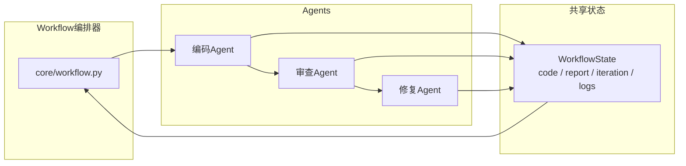
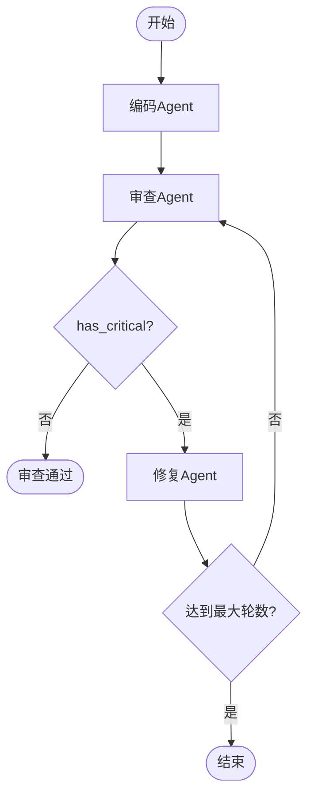

# 设计文档（Design.md）

## 1. 项目概述

本项目实现一个「代码审查 Workflow」，用 **3 个 Agent 协作**完成「编码 → 审查 → 修复」的端到端流程，重点实践 Workflow 编排、Agent 间通信与状态管理。

## 2. 整体架构



- **编排器（Workflow）**：负责按流程调度 Agent，实现顺序、条件、循环控制
- **Agent（3 个）**：各自职责单一，通过共享状态通信
- **共享状态（WorkflowState）**：所有 Agent 读写同一份数据，是通信的「黑板」

## 3. Agent 间通信：黑板模式（共享状态）

Agent 之间**不直接调用彼此**，而是通过 `WorkflowState` 交换数据：

| Agent | 读取 | 写入 |
|-------|------|------|
| 编码 Agent | `state.raw_input` | `state.code` |
| 审查 Agent | `state.code` | `state.review_report`（JSON） |
| 修复 Agent | `state.code` + `state.review_report` | `state.code`（修复后） |

这种设计让 Agent 解耦：新增 Agent 只需遵守状态字段约定，无需修改其它 Agent。

## 4. 流程控制设计



- **顺序执行**：编码 → 审查（基础要求）
- **条件分支**：根据审查报告的 `has_critical` 字段决定是否修复
- **循环**：审查 → 修复 → 再审查，最多 `MAX_REVIEW_ROUNDS` 轮

## 5. 状态管理

```python
@dataclass
class WorkflowState:
    raw_input: str        # 用户原始输入
    code: str             # 当前代码（被各 Agent 反复读写）
    review_report: dict   # 审查报告（JSON）
    iteration: int        # 已循环轮数
    max_iterations: int   # 最大循环轮数
    logs: list            # 日志
    history: list         # 每个 Agent 的输入输出记录（用于追踪）
```

- 每次 Agent 运行后都会 `record()` 记录到 `history`，用于状态追踪
- 流程结束后，`to_dict()` 导出完整状态到 `logs/result_*.json`

## 6. 可扩展性设计

1. **BaseAgent 抽象类**：统一 `run(state)` 接口，新增 Agent = 继承 + 实现一个方法
2. **注册表机制**：`Workflow.registry` 维护「名称 → Agent」映射，`add_agent()` 即可扩展
3. **流程配置化**：`MAX_REVIEW_ROUNDS` 等在 `config.py` 配置，改流程无需改核心代码
4. **结构化通信**：审查报告用 JSON，下游 Agent 稳定解析

**新增一个 Agent 只需三步**：继承 `BaseAgent` → 实现 `run()` → 在 `Workflow.registry` 注册。

## 7. 与项目 1 的复用关系

| 项目1 内容 | 项目2 复用方式 |
|-----------|---------------|
| 代码审查提示词 | `reviewer.py` 的审查维度与输出规范 |
| LLM 客户端 + 重试 | `llm.py` 的 `chat()`（指数退避重试 3 次） |
| read_file / run_linter 工具 | `tools.py` |
| DeepSeek Key 读取逻辑 | `config.py`（可复用项目1的 key.txt） |

## 8. 技术选型理由

- **DeepSeek + openai SDK**：与项目1一致，无新学习成本
- **JSON 输出模式**（`response_format`）：让审查报告结构化，避免解析自由文本
- **dataclass 管理状态**：类型清晰、易序列化，适合状态追踪与存档
