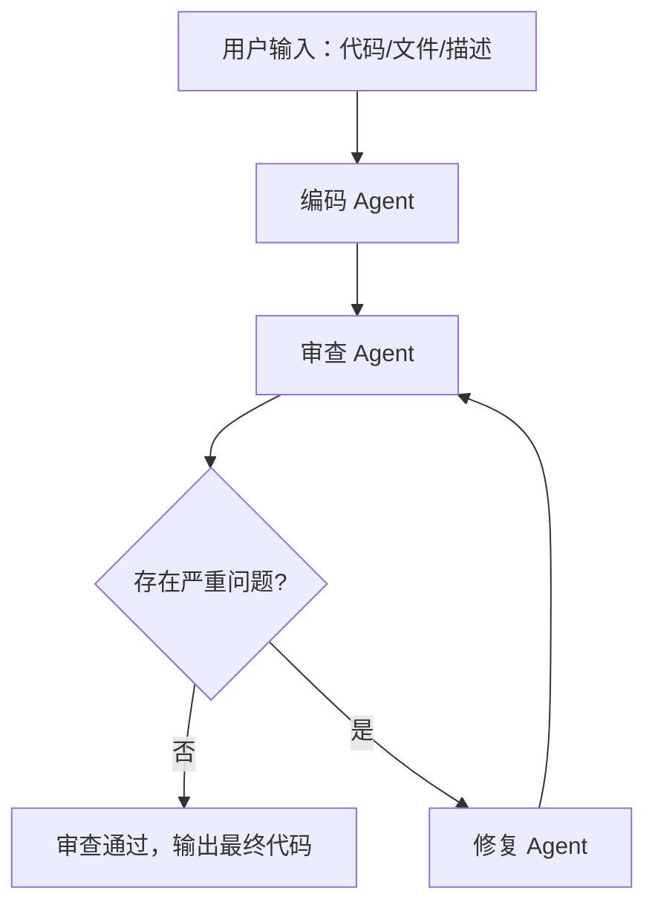

# 代码审查 Workflow（Code Review Workflow）

一个由 **3 个 Agent 协作**完成的端到端代码审查流程，是「Homework 2」的作业实现。它复用项目 1（code-review-agent）的审查逻辑，理解并实践了 **Workflow 编排、Agent 间通信、状态管理** 三大核心概念。

## 功能特性

- **3 个 Agent 协作**：编码 Agent → 审查 Agent → 修复 Agent
- **端到端流程**：输入代码/文件/描述 → 自动审查 → 自动修复 → 输出改进后的代码
- **循环流程控制**：审查 → 修复 → 再审查，最多 N 轮自动收敛
- **条件分支**：无严重问题时跳过修复、直接通过
- **结构化通信**：审查报告使用 JSON，便于下游 Agent 消费
- **状态共享（黑板模式）**：`WorkflowState` 作为共享状态，Agent 间解耦
- **执行日志与状态追踪**：每步日志打印 + 写入 `logs/`，结果 JSON 存档
- **错误处理与重试**：LLM 调用失败自动重试（最多 3 次）
- **可扩展架构**：`BaseAgent` 抽象类 + 注册表，新增/替换 Agent 无需改动核心流程

## 目录结构

```
code-review-workflow/
├── main.py              # CLI 入口
├── config.py            # API Key、模型、最大审查轮数
├── llm.py               # LLM 客户端（复用项目1，含重试、JSON 解析）
├── tools.py             # 工具：read_file / run_linter（复用项目1）
├── core/
│   ├── state.py         # WorkflowState：共享状态
│   ├── workflow.py      # Workflow 编排器（顺序 + 条件 + 循环）
│   └── logger.py        # 执行日志
├── agents/
│   ├── base.py          # BaseAgent 抽象基类
│   ├── coder.py         # 编码 Agent
│   ├── reviewer.py      # 审查 Agent（复用项目1）
│   └── fixer.py         # 修复 Agent
├── examples/
│   └── buggy.py         # 演示用样例代码
├── requirements.txt
├── README.md
└── Design.md
```

## 快速开始

### 1. 安装依赖

```powershell
pip install -r requirements.txt
```

### 2. 配置 API Key（三选一）

- **方式 A**：在项目根目录新建 `key.txt`，粘贴 DeepSeek Key
- **方式 B**：设置环境变量 `$env:DEEPSEEK_API_KEY="sk-xxx"`
- **方式 C**：直接复用项目 1 的 `key.txt`（位于 `../code-review-agent/key.txt`）

> `key.txt` 已加入 `.gitignore`，不会上传。

### 3. 运行

```powershell
python main.py
```

### 4. 使用示例

**输入方式一：直接粘贴代码**
```
请输入：
def divide(a, b):
    return a / b
```

**输入方式二：文件路径**
```
请输入：
examples/buggy.py
```

**输入方式三：功能描述（编码 Agent 会先帮你生成代码）**
```
请输入：
写一个计算平均值的函数
```

## 技术栈

- 语言：Python
- LLM：DeepSeek（OpenAI 兼容接口）
- 复用项目1：审查提示词、LLM 重试机制、read_file / run_linter 工具
- 无额外框架依赖

## 流程示意


